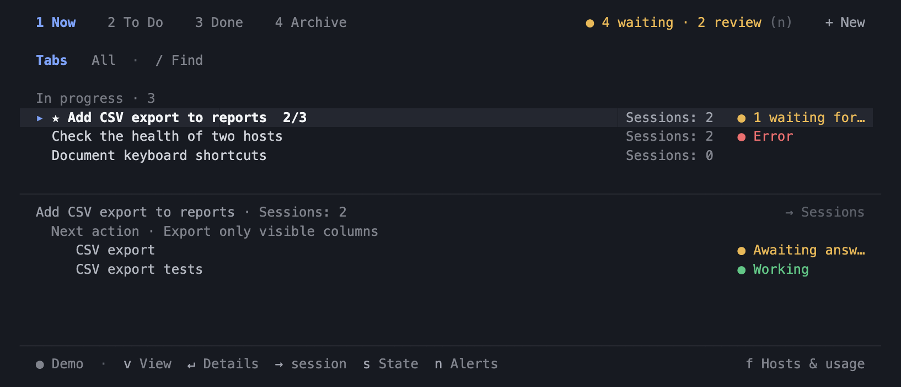
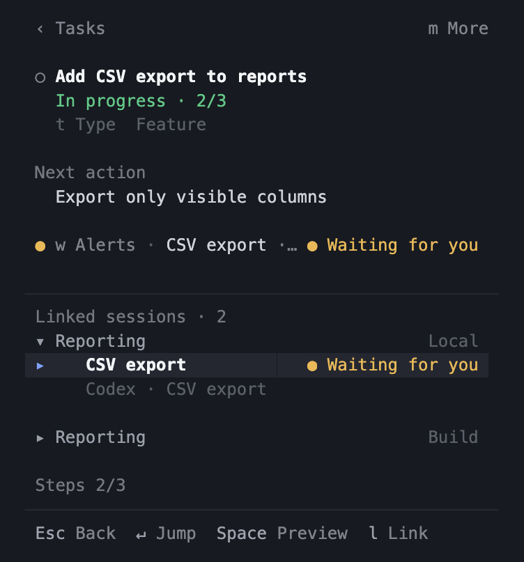
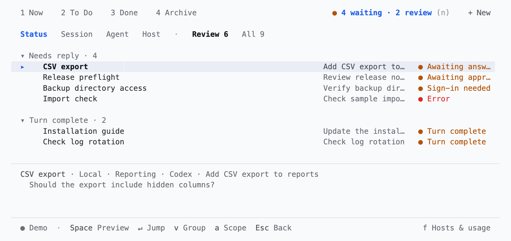

# rextd

English · [简体中文](README.zh-CN.md)

rextd is a task sidebar for [Rex](https://www.superlogical.com/rex). When several coding agents are working at once, pick a task to see its next step, which panes belong to it, and which one needs a reply. Open the waiting pane to answer, then return to the same task.



The screenshots follow one sample task in **v0.0.2**. Try the same board with `./rextd --demo`. [Download v0.0.2](https://github.com/anewme7/rextd/releases/tag/v0.0.2) · [User guide](docs/user-guide.md)

## Install and open the sidebar

### Single machine

Install Rex on your machine, open a Rex terminal and run the block for your platform below. [Rex installation](https://www.superlogical.com/rex/docs/installation)

You'll need the `rex` command for live status and pane navigation. The release includes SQLite and runs without a Go toolchain.

<details open>
<summary><strong>macOS · Apple Silicon</strong></summary>

```sh
release=https://github.com/anewme7/rextd/releases/download/v0.0.2
pkg=rex-td_darwin_arm64
dest="$HOME/.local/opt/rextd/v0.0.2"
mkdir -p "$dest" && cd "$dest" &&
  curl -fLO "$release/$pkg.tar.gz" &&
  curl -fLO "$release/$pkg.tar.gz.sha256" &&
  shasum -a 256 -c "$pkg.tar.gz.sha256" &&
  tar -xzf "$pkg.tar.gz" &&
  cd "$pkg"
```

</details>

<details>
<summary><strong>Linux · x86-64</strong></summary>

```sh
release=https://github.com/anewme7/rextd/releases/download/v0.0.2
pkg=rex-td_linux_amd64
dest="$HOME/.local/opt/rextd/v0.0.2"
mkdir -p "$dest" && cd "$dest" &&
  curl -fLO "$release/$pkg.tar.gz" &&
  curl -fLO "$release/$pkg.tar.gz.sha256" &&
  sha256sum -c "$pkg.tar.gz.sha256" &&
  tar -xzf "$pkg.tar.gz" &&
  cd "$pkg"
```

</details>

After the checksum reports `OK`, run `./rextd --version` in the same shell. It should print `rextd v0.0.2`. Try the sample tasks before opening your own board. Press `n` to see what needs a reply, Esc to go back, and `q` to quit. The demo keeps its data in memory.

```sh
./rextd --demo --lang en
```

To open your own board alongside your current Rex pane, run this from the same directory. Press **Shift+L** to switch between English and Simplified Chinese at any time.

```sh
rex run --split=right --ratio 35 --shell=none --label rextd -- "$PWD/rextd" --lang en
```

## Use one board across hosts

Suppose the board runs on your Mac and a coding agent runs on a Linux machine called `build`. Install rextd on the Mac using the steps above. The Linux machine needs Rex Server and your agent. The Mac keeps the task database. [Install Rex Server on Linux](https://www.superlogical.com/rex/docs/linux/installation)

1. On the Mac, register the Linux server. If you already have SSH access, replace `alice@build.example.com` with your SSH login and address. If the server is already listed in Rex, skip the first command. Look for `reachable` in the check output. [Rex remote access](https://www.superlogical.com/rex/docs/linux/remote-access)

   ```sh
   rex hosts add build ssh://alice@build.example.com
   rex hosts check build
   ```

2. In the **same Rex app**, open a session on each server. On the Mac, go to **Settings → General → Client Info**, give the device a unique **Label** and enable **Remote Control**. Use a different label on each device you intend to jump from. [Rex settings](https://www.superlogical.com/rex/docs/reference/mac-settings#setting-client-info-label)
3. Start the agent in a Rex pane on Linux. On the Mac board, press `n` for Alerts, then `a` to include working panes. Press `v` until the list is grouped by **Host**. Select the agent under **build**. Space previews the terminal, Esc returns to the row, and Enter takes you to the Linux pane. Use the Mac board tab to return, or use **td / Open Task Board** on the Mac after setting up the command palette below.

Remote CPU readings are optional. Pane status and jumps work without the metrics action. [Remote CPU setup](docs/user-guide.md#enable-remote-cpu)

## Start a task and see its agent sessions

1. **Create the task.** Press `+`, type a title such as “Add CSV export to reports”, and press Enter. Select it and press `s` to put it **In progress**. Press `e` to record the next action, such as “Export only visible columns”.
2. **Start the agent.** With the task selected, press **Shift+N** to open its Rex tab. Start your coding agent in that tab so rextd can link the new pane. On the board, select the task to see its sessions below. If a pane appears under **Unassigned**, select that row, press →, then choose the pane and confirm its task with Enter.
3. **Check the work.** Press Enter on the task for its next action, linked sessions and subtasks. From the board you can also press → to select a session directly. Press Space to read its live terminal output, Esc to return to the selected row, or Enter to jump into the pane and type.



In a narrow pane, the next action stays above the session list. On an iPhone, swipe to read further down and tap a row to select it. Each Rex client can open its own board window.

## Find the agent waiting for you

Press `n` to open **Alerts**. In the example below, four panes need input and two have finished a turn. Selecting **CSV export** reveals the actual question, “Should the export include hidden columns?” On a live board, press Enter to answer in that pane.



| What you want to do | From the board or Alerts |
| --- | --- |
| See work by task state | `1` Now · `2` To Do · `3` Done · `4` Archive. Press `v` on the board to see all four sections together. |
| Find a pane by host or agent | In Alerts, `v` cycles through Status, Session, Agent and Host. Press `a` to include all panes. |
| Read earlier terminal output | Select a pane and press Space. Scroll back, press End to follow live output, or press Space again to return. |
| Check a machine or a quota | Press `f` for Hosts, again for Usage, and once more to close. Esc also closes the drawer. |
| Find other shortcuts | Press `?` in the sidebar. |

## Add rextd to the Rex command palette

Copy the settings from the [example configuration](rex/init.example.lua) into Rex's `init.lua`. Set `rextd_root` to the absolute path of the extracted folder containing both `rextd` and `rex/`. Check the config, then reload it on that server.

```sh
rex config check && rex config reload
```

On macOS, press **⌘⇧P** and search for **td**.

| Command | When to use it |
| --- | --- |
| **td / Open Task Board** | After jumping into a pane, return to where you left off on this client's board. |
| **td / Find Task…** | Search by title, including archived tasks. Open an archived task's details or jump to an active task's linked pane. |
| **td / Capture Current Pane…** | Turn the pane you're in into a new task or attach it to an existing unarchived task. |
| **td / Tasks** | Go straight to **Now**. The optional Raycast `td` shortcut also opens this page. |
| **td / Show Host 1** | Open Alerts filtered to the first host. |

If you start the sidebar with a custom `REX_TD_DATA_DIR`, set `rextd_data_dir` in Rex to the same absolute directory so the palette opens the same tasks. Set `rextd_language = "zh"` for Chinese palette entries. [Agent details, CPU and quota setup](docs/user-guide.md#optional-integrations)

## Data, updates, and removal

Tasks, next actions and pane links live in a local SQLite file on the machine running the board. The default is `~/.local/share/rex-td/tasks.sqlite3`. If set, `$XDG_DATA_HOME/rex-td` replaces the default directory. An absolute `REX_TD_DATA_DIR` takes precedence over both. Back up the database before upgrading. [Backup, update and removal instructions](docs/user-guide.md#back-up-update-or-remove)

## Build from source

With Go 1.24 or later, run the following in a Rex pane from the repository root. macOS also needs the Xcode command line tools and CGO enabled.

```sh
REX_TD_LANG=en ./scripts/preview.sh --demo
```

The preview binary is built at `~/dev/rextd/work/preview/rextd`. Omit `--demo` for a separate live board. On a machine with the managed installation, `--copy-prod-data` opens a disposable working copy of the production tasks. To build a local archive and its checksum, run `sh scripts/package.sh "$HOME/dev/rextd/work/preview/release-check"`.

[MIT License](LICENSE)
