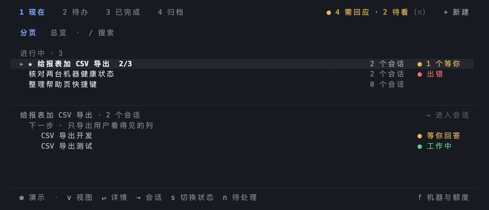
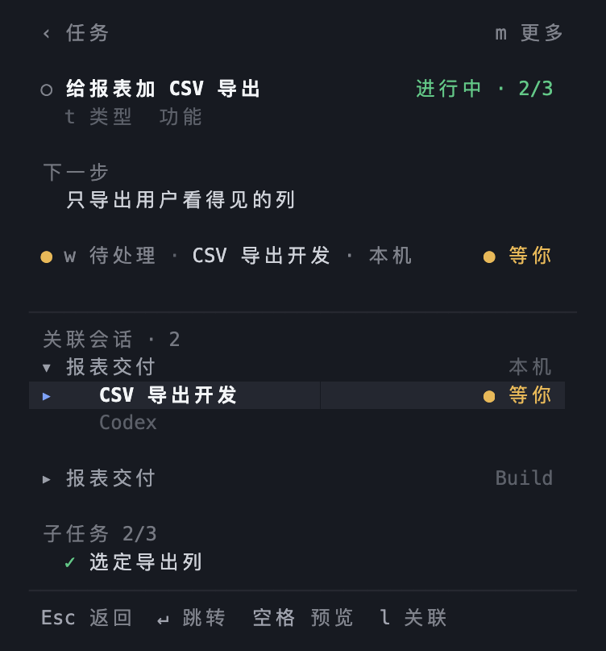
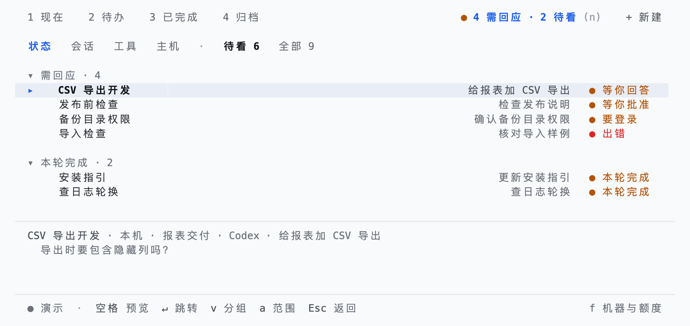

# rextd

[English](README.md) · 简体中文

rextd 是 [Rex](https://www.superlogical.com/rex) 里的任务侧栏。几个编程助手同时开工时，选中一项任务，就能看到下一步要做什么、它关联了哪些窗格、谁在等你回答。按回车跳过去回复，处理完还能回到刚才的位置。



本文用 **v0.0.2** 的同一个示例任务串起三个画面。运行 `./rextd --demo --lang zh` 就能打开图中的看板。[下载 v0.0.2](https://github.com/anewme7/rextd/releases/tag/v0.0.2) · [详细使用手册（英文）](docs/user-guide.md)

## 安装并打开侧栏

### 单机使用

先安装 Rex，在 Rex 里打开终端，按这台机器的平台选择下面一组命令运行。[Rex 安装指南](https://www.superlogical.com/rex/docs/installation)

查看实时状态和跳转窗格需要能运行 `rex` 命令。安装包已包含 SQLite，下载后即可运行，无需安装 Go。

<details open>
<summary><strong>macOS · Apple 芯片</strong></summary>

```sh
release=https://github.com/anewme7/rextd/releases/download/v0.0.2
pkg=rex-td_darwin_arm64
dest="$HOME/.local/opt/rextd/v0.0.2"
mkdir -p "$dest" && cd "$dest" &&
  curl -fLO "$release/$pkg.tar.gz" &&
  curl -fLO "$release/$pkg.tar.gz.sha256" &&
  shasum -a 256 -c "$pkg.tar.gz.sha256" &&
  tar -xzf "$pkg.tar.gz" &&
  cd "$pkg"
```

</details>

<details>
<summary><strong>Linux · x86-64</strong></summary>

```sh
release=https://github.com/anewme7/rextd/releases/download/v0.0.2
pkg=rex-td_linux_amd64
dest="$HOME/.local/opt/rextd/v0.0.2"
mkdir -p "$dest" && cd "$dest" &&
  curl -fLO "$release/$pkg.tar.gz" &&
  curl -fLO "$release/$pkg.tar.gz.sha256" &&
  sha256sum -c "$pkg.tar.gz.sha256" &&
  tar -xzf "$pkg.tar.gz" &&
  cd "$pkg"
```

</details>

校验显示 `OK` 后，在同一个终端运行 `./rextd --version`，应显示 `rextd v0.0.2`。接下来可以先体验示例。按 `n` 看谁需要回应，按 Esc 返回，按 `q` 退出。示例任务只存在于内存里。

```sh
./rextd --demo --lang zh
```

准备记录自己的任务时，在同一目录运行下面这条命令。看板会在当前 Rex 窗格右侧打开，按 **Shift+L** 可随时切换中英文。

```sh
rex run --split=right --ratio 35 --shell=none --label rextd -- "$PWD/rextd" --lang zh
```

## 多台主机共用一个看板

以「Mac 上开看板、Linux 上跑编程助手」为例。按上面的步骤在 Mac 安装 rextd，任务库保存在 Mac。Linux 上装好 Rex Server 和要用的编程助手即可。[Linux 安装 Rex Server](https://www.superlogical.com/rex/docs/linux/installation)

1. 在 Mac 上登记 Linux 主机。如果平时用 SSH 登录，把下面的 `alice@build.example.com` 换成自己的用户名和地址。`build` 是这台主机在 Rex 里的名字。已经添加过就直接运行第二条，把 `build` 换成已有的名字。结果应显示 `reachable`。[Rex 远程连接指南](https://www.superlogical.com/rex/docs/linux/remote-access)

   ```sh
   rex hosts add build ssh://alice@build.example.com
   rex hosts check build
   ```

2. 用**同一个 Rex 客户端**分别打开 Mac 和 Linux 上的会话。在 Mac 的 **Settings → General → Client Info** 里，为这台设备填一个独立的 **Label**，并开启 **Remote Control**。如果也用手机跳转，给手机取另一个名字。[Rex 设置说明](https://www.superlogical.com/rex/docs/reference/mac-settings#setting-client-info-label)
3. 在 Linux 的 Rex 窗格启动助手。回到 Mac 看板，按 `n` 进「待处理」，按 `a` 把正在工作的窗格也列出来，再按 `v` 切到「主机」分组。在 `build` 下选中助手，按空格预览，Esc 返回原行，回车进入 Linux 窗格。处理完切回 Mac 的看板标签页，或在配好下方命令面板后，在 Mac 上选「td / 打开任务看板」。

需要看远程 CPU 时，再在对应主机启用采集。只看窗格状态和跨机器跳转，可以直接用上面的配置。[远程 CPU 配置（英文）](docs/user-guide.md#enable-remote-cpu)

## 从一个任务找到它的会话

1. **记下任务和下一步。** 按 `+`，输入「给报表加 CSV 导出」，回车保存。选中任务，按 `s` 切到「进行中」，再按 `e` 写下「只导出用户看得见的列」。
2. **在任务里开工。** 选中任务，按 **Shift+N** 打开它在 Rex 里的标签页，再在里面启动编程助手。回到看板，选中任务就能在下方看到关联会话。如果已有窗格出现在「未归类」，选中「未归类」后按 →，选好窗格，再用回车选择并确认它属于哪个任务。
3. **看进度，回到现场。** 在任务上按回车，能看到下一步、关联会话和子任务。也可以直接在看板按 → 选中会话。按空格先读终端输出，按 Esc 回到原来那一行；要输入回复，就按回车进入窗格。



在这个 47 列宽的窗格里，下一步仍排在会话列表上方。在 iPhone 上可以上滑继续阅读，点某一行选中。手机和电脑各自有自己的看板窗口。

## 找到正在等你回答的问题

按 `n` 打开「待处理」。下图有四个窗格需要回应，另有两个刚完成一轮工作。选中「CSV 导出开发」，下方就能读到原话：「导出时要包含隐藏列吗？」在自己的实时看板里，此时按回车就能跳过去作答。



| 想做什么 | 怎么操作 |
| --- | --- |
| 按进度看任务 | `1` 现在、`2` 待办、`3` 已完成、`4` 归档。在看板按 `v`，可在「分页」和四组同屏的「总览」之间切换。 |
| 按主机或工具找窗格 | 在「待处理」按 `v`，依次按状态、会话、工具、主机分组。按 `a` 可看全部窗格。 |
| 翻看之前的终端输出 | 选中窗格按空格预览，向上滚动看前文，按 End 跟随最新输出，再按空格回到列表。 |
| 看机器负载或剩余额度 | 按一次 `f` 看主机和 CPU，再按看各工具的额度与重置时间，第三次关闭。Esc 也能收起。 |
| 查其他按键 | 在侧栏按 `?` 打开快捷键表。 |

## 把看板加进 Rex 命令面板

把[示例配置](rex/init.example.lua)里的设置复制到 Rex 的 `init.lua`。`rextd_root` 填解压目录的绝对路径，该目录下应同时有 `rextd` 程序和 `rex/` 文件夹。加上 `rextd_language = "zh"` 可让命令面板和新开的看板使用中文。在这台服务器上检查并重载配置。

```sh
rex config check && rex config reload
```

在 Mac 上按 **⌘⇧P**，输入 **td** 就能找到这五个入口。

| 命令 | 什么时候用 |
| --- | --- |
| **td / 打开任务看板** | 刚从看板跳进某个窗格，想回到这台设备上刚才看的位置。 |
| **td / 查找任务…** | 按标题找任务，归档也能搜到。选归档任务看详情，选有关联窗格的活动任务可直接跳转。 |
| **td / 收录当前窗格…** | 手头这个窗格值得跟进，把它建成新任务，或关联到已有的未归档任务。 |
| **td / 任务首页** | 直接回「现在」。配好 Raycast 的 `td` 快捷入口后，打开的也是这一页。 |
| **td / 显示 1 号主机** | 只看第一台主机有哪些窗格待处理。 |

如果启动侧栏时自定义了 `REX_TD_DATA_DIR`，请把 Rex 配置中的 `rextd_data_dir` 设为同一绝对路径，这样命令面板和侧栏读到的是同一份任务。[会话详情、CPU 与额度配置（英文）](docs/user-guide.md#optional-integrations)

## 任务存在哪里，升级前怎么备份

任务、下一步和窗格关联都保存在运行看板的机器上。默认文件是 `~/.local/share/rex-td/tasks.sqlite3`。设置了 `XDG_DATA_HOME` 时，数据目录改用 `$XDG_DATA_HOME/rex-td`。显式指定的绝对路径 `REX_TD_DATA_DIR` 优先级最高。升级前可以在看板运行时备份数据库，再检查备份能否打开。[备份命令、升级与卸载（英文）](docs/user-guide.md#back-up-update-or-remove)

## 从源码预览

准备 Go 1.24 或以上版本，在 Rex 窗格中进入仓库根目录运行下方命令。macOS 还需要安装 Xcode 命令行工具并启用 CGO。

```sh
REX_TD_LANG=zh ./scripts/preview.sh --demo
```

预览程序会构建到 `~/dev/rextd/work/preview/rextd`。去掉 `--demo` 可以打开独立的实时看板。使用本机托管安装时，`--copy-prod-data` 可用正式任务的临时副本调试。本机打包命令是 `sh scripts/package.sh "$HOME/dev/rextd/work/preview/release-check"`，会同时生成压缩包和校验文件。

[MIT 许可证](LICENSE)
